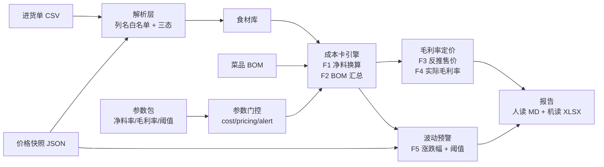

# 菜谱/食堂采购成本核算器

> **状态**：🚧 v0.1.0 开发中（M0 骨架已落地，M1 数据先行待开工）

把"进货单导入 → 净料换算 → 菜品成本卡 → 毛利率定价 → 价格波动预警"做成**确定性规则引擎**：结论 100% 可复现、纯本地运行、零账号零上传零遥测，内置公开批发价快照做基准真值。

## 为什么需要它

小餐饮店/食堂的采购成本核算普遍停留在"老板记忆 + Excel 手工表"：进货价每天变、毛料换净料凭经验、一道菜到底挣多少钱没人算得清。

实测价格波动数据（公开批发价，抓取日期 2026-10-14）：大白菜均价 2026-08-06 = 0.55 元/斤 → 2026-09-06 = 0.53 元/斤 → 2026-10-06 = 0.40 元/斤（两月 **−27%**）。同类菜品两个月内成本波动可达两成以上，手工 Excel 既不会感知、更不会重算受影响菜品。

**Excel 和聊天给不了的**：Excel 不会自动净料换算、不会在两期价格快照间自动重算受影响菜品并出预警清单；LLM 聊天给不了持久库、确定口径与可复现基准。

## 特性

- **确定性规则引擎**：全部结论由规则产生，无 LLM、无 API 依赖、无随机数（自研 splitmix64 保跨平台可复现）。
- **Decimal 全链路**：金额与比率一律 `Decimal`，能检出 1 分差异，无 float 尾差。
- **参数来源标记体系**：每个进入计算路径的参数必须挂来源（快照 / 用户 / 内置经验值）；未挂来源的参数**不得进入计算路径**。
- **快照式波动预警**：两期价格快照 → 受影响菜品逐菜重算前后成本差 → 超阈值提示清单（**预警 ≠ 判定，不自动改价**）。
- **门控按计算路径分作用域**：`cost` / `pricing` / `alert` 各只校验自己引用的条目，与核算无关的待核对参数不会阻断整个核算路径。
- **零字面量门禁**：业务数值只能来自参数包，抄进代码即被门禁拦下（扫描面含 docstring 与注释）。
- **双形态交付**：CLI（脚本化通路）+ PySide6 桌面界面（只消费编排层 API，零判定逻辑）。
- **纯本地**：无账号、无上传、无遥测；不联网拉价（首期只用内置快照，含抓取日期）。

## 架构



## 快速开始

```bash
# 1. 安装（开发形态）
python -m pip install -U pip
python -m pip install -e ".[dev]"

# 2. 生成参数包与样例数据（冻结产物）
python tools/gen_params.py
python tools/gen_samples.py

# 3. 端到端核算（退出码 1 = 有异常行，属明示语义）
rcc run --purchases data/samples/purchases-demo.csv --bom data/samples/bom-demo.json

# 4. 导出报告（人读 Markdown + 机读 XLSX）
rcc run --purchases data/samples/purchases-demo.csv --bom data/samples/bom-demo.json --report out/report

# 5. 校验输入数据
rcc check --purchases data/samples/purchases-demo.csv --bom data/samples/bom-demo.json

# 6. 跑内置基准
rcc bench

# 7. 自检
rcc selftest

# 8. 桌面界面（需额外安装 gui extra）
python -m pip install -e ".[gui]"
rcc gui
```

## 评测

基准套件分两层（样本驱动 + 规则驱动），指标以末态实测回填。门槛随 `data/truth/manifest.json` 下发（**数据不是代码**），基准层只读，缺失即报配置错误。

| 套件 | 层 | 证明什么 | 指标 |
|---|---|---|---|
| `import` | 样本驱动 | 进货单解析在这些样本上对 | ⬜ M4 回填 |
| `costcard` | 样本驱动 | 成本卡端到端在这些样本上对 | ⬜ M4 回填 |
| `alert` | 样本驱动 | 预警清单与排序在这些样本上对 | ⬜ M4 回填 |
| `boundary` | **规则驱动** | 引擎在**所有**有限端点上对（不读真值库） | ✅ 端点全通过 |
| `reconcile` | **双向对账** | 公式推导端点 vs 穷举扫描恢复点互验 | ✅ 两路径一致 |

**未启用的套件不冒充通过**：分母为 0 时标记 `not_enabled` 并退出码 1，不记为"达标"。

## 目录结构

```
plan/        计划与留档（00 总览 / 01 题目 / 02 算法与口径 / 03 基准设计 / 04 测试验收 / 05 发布交付 / 06 架构选型）
data/        数据资产（README 依据查证 / rules 参数包 / samples 样例 / snapshots 快照 / truth 真值库）
src/rcc/     唯一包（cli / model / rules / io / engine / alert / report / gui / packaging）
benchmark/   基准套件（runner + cases 对账语义单一实现源）
tools/       生成器与门禁（gen_params / gen_samples / check_literals / audit_desensitize / detrng）
tests/       unit / guards / integration / benchmark / gui（138 项，双解释器 3.8 与 3.12 全绿）
```

## 限制

- **不做**进销存系统（不管理出入库流水）、财务系统（不做总账/报表/税务）、点餐/收银系统。
- **不联网拉价**：首期只用内置价格快照（含抓取日期留档）；联网拉取列为扩展项。
- **净料率/损耗率无官方公开表**：内置值为**经验值**，用户须自行核对并可按自身情况配置。
- **不含营养成分计算**（列为扩展项）。
- 首期仅支持 CSV 进货单（Excel 列为后续形态）。

## 数据来源声明

- 价格数据来自**公开批发价快照**（新发地批发价格接口），逐份记录抓取日期与 sha256；快照文件只增不改。
- 净料率、损耗率、目标毛利率、波动阈值的内置值**均为经验值或示例值，非官方数据**——报告中逐处标注来源类型。
- 方法论锚点为"行业惯例 + 烹饪教材方法（毛料→净料出成率换算）"，未引用任何未查证到的标准编号。

## 免责声明

本工具为**辅助核算工具**，非财务/经营决策工具。所有输出仅供成本参考，不构成定价建议；用户须自行核对参数并承担经营决策责任。

## 已知环境问题

- **本机 Python 通道**：Windows 上 `python` 可能是商店占位符，请用 `py -3.12` / `py -3.8`；venv 内用 `python`。
- **构建工具版本**：打桌面界面（PySide6）必须 **PyInstaller ≥6**（5.x 在扫描 PySide6 字节码时确定性失败）；只打 CLI 可用 5.x。
- **`py` 启动器会无视 venv**：venv 段落一律用 `python -m pip ...`，不用 `py -m pip ...`。
- **控制台编码**：程序入口已做 UTF-8 守卫；若在非 UTF-8 控制台看到乱码，用 `py -X utf8`。

## 许可

MIT，见 [LICENSE](LICENSE)。
