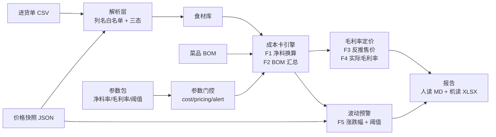

# 菜谱/食堂采购成本核算器

> **状态**：🚧 v0.1.0 开发中（M0 骨架、M1 数据先行、M2 导入已落地；M3 核算引擎待开工）

把"进货单导入 → 净料换算 → 菜品成本卡 → 毛利率定价 → 价格波动预警"做成**确定性规则引擎**：结论 100% 可复现、纯本地运行、零账号零上传零遥测，内置公开批发价快照做基准真值。

## 为什么需要它

小餐饮店/食堂的采购成本核算普遍停留在"老板记忆 + Excel 手工表"：进货价每天变、毛料换净料凭经验、一道菜到底挣多少钱没人算得清。

实测价格波动数据（公开批发价，快照已入库，抓取日期 2026-10-15）：大白菜均价 2026-08-06 = 0.55 元/斤 → 2026-09-06 = 0.53 元/斤 → 2026-10-06 = 0.40 元/斤（两月 **−27%**）。同类菜品两个月内成本波动可达两成以上，手工 Excel 既不会感知、更不会重算受影响菜品。（逐份快照的抓取日期与 sha256 见 [data/snapshots/README.md](data/snapshots/README.md)。）

**Excel 和聊天给不了的**：Excel 不会自动净料换算、不会在两期价格快照间自动重算受影响菜品并出预警清单；LLM 聊天给不了持久库、确定口径与可复现基准。

## 特性

- **确定性规则引擎**：全部结论由规则产生，无 LLM、无 API 依赖、无随机数（自研 splitmix64 保跨平台可复现）。
- **进货单导入三态判定**：`ok` / `invalid` / `unknown` 逐行判定，**异常行一律列入清单并打印**（绝不静默跳过）；形态问题（空文件/坏编码/缺表头）与行问题给**不同退出码**。
- **口径单一定义点**：换算公式 F1–F6 只在 `rules/formulas.py` 定义一处，plan/02 §一 的公式原文被 docstring 逐字复述，**有守门断言两处一致**（同一算式在源码里只准有一份实现）。
- **Decimal 全链路**：金额与比率一律 `Decimal`，能检出 1 分差异，无 float 尾差。
- **参数来源标记体系**：每个进入计算路径的参数必须挂来源（快照 / 用户 / 内置经验值）；未挂来源的参数**不得进入计算路径**（来源在**消费点**校验，不只在构造期）。
- **快照式波动预警**：两期价格快照 → 受影响菜品逐菜重算前后成本差 → 超阈值提示清单（**预警 ≠ 判定，不自动改价**）。
- **门控按计算路径分作用域**：`cost` / `pricing` / `alert` 各只校验自己引用的条目，与核算无关的待核对参数不会阻断整个核算路径；`input_required`（本不由参数包承载的输入）**放行门控但运行时必索**，缺失即退出码 2，**绝不静默取默认值**。
- **行级失败不中断整批**：净料率越界或用量非法 → **该道菜**从成本卡排除并逐条列清单（退出码 1）；全部菜品都被排除 → 成本卡为空（退出码 2）。**不静默取 0/1、不丢行求和**。
- **零字面量门禁**：业务数值只能来自参数包，抄进代码即被门禁拦下（**扫描面为整包 `src/rcc` + `benchmark/`**，含 docstring 与注释）。
- **双形态交付**：CLI（脚本化通路）+ PySide6 桌面界面（只消费编排层 API，零判定逻辑）。
- **纯本地**：无账号、无上传、无遥测；不联网拉价（首期只用内置快照，含抓取日期）。

## 架构



## 快速开始

```bash
# 1. 安装（开发形态）
python -m pip install -U pip
python -m pip install -e ".[dev]"

# 2. 生成参数包、样例数据与真值库（冻结产物）
python tools/gen_params.py
python tools/gen_samples.py
python tools/gen_truth.py

# 3. 端到端核算（退出码 1 = 有异常行，属明示语义）
rcc run --purchases data/samples/purchases-demo.csv --bom data/samples/bom-demo.json

# 4. 价格波动预警（两期真实快照，已随仓库入库；退出码 1 = 有异常行）
rcc run --purchases data/samples/purchases-demo.csv --bom data/samples/bom-demo.json --with-alert --snapshots data/snapshots/xinfadi-2026-08-06.json data/snapshots/xinfadi-2026-10-06.json

# 5. 导出报告（人读 Markdown + 机读 XLSX）
rcc run --purchases data/samples/purchases-demo.csv --bom data/samples/bom-demo.json --report out/report

# 6. 校验输入数据
rcc check --purchases data/samples/purchases-demo.csv --bom data/samples/bom-demo.json

# 7. 跑内置基准
rcc bench

# 8. 自检
rcc selftest

# 9. 桌面界面（需额外安装 gui extra）
python -m pip install -e ".[gui]"
rcc gui
```

### 冻结产物复核（离线，可复验）

```bash
# 参数包 / 样例 / 真值库：重生成后与入库件逐字节比对（手改即被检出）
python tools/gen_params.py --check       # FROZEN_PARAMS_OK
python tools/gen_samples.py --check      # FROZEN_SAMPLES_OK
python tools/gen_truth.py --check        # FROZEN_TRUTH_OK
```

### 快照复核（离线，数据留档可复验）

```bash
# 重算 sha256 并与台账逐项核对（不联网）
python tools/fetch_snapshots.py --check
# 阳性/阴性对照：篡改必被检出（不联网）
python tools/fetch_snapshots.py --selftest
# 重新抓取三个数据日并与留档件逐字节比对（联网；验证跨抓取字节稳定）
python tools/fetch_snapshots.py --refetch-check
```

### 进货单格式（导入契约）

CSV，**UTF-8 编码**（带 BOM 亦可，Excel「另存为 CSV UTF-8」即此形态），首行为表头：

| 列名 | 必填 | 说明 |
|---|---|---|
| 日期 | 否 | 进货日期（`YYYY-MM-DD`） |
| 品名 | **是** | 食材名，须与参数包 `yield_rates` 的键一致，否则引擎要求显式提供净料率 |
| 类别 | 否 | 如 蔬菜 / 肉禽蛋 / 水产 |
| 数量 | **是** | 非负数值 |
| 单位 | 否 | 如 斤 / 公斤 / 个（未登记单位会提示，**不做单位换算**） |
| 单价 | **是** | 非负数值（**毛料**进货单价） |
| 金额 | 否 | 留档参考列，**不参与计算**，故不校验数值性 |

**列顺序任意**（按列名映射，不按位置）；未登记的额外列会记一条 `unknown` 提示但**不影响该行**。

导入三态与退出码：

| 情形 | 判定 | 退出码 |
|---|---|---|
| 全部列名命中 + 数值校验通过 | `ok` | 0 |
| 必填列为空 / 非数值 / 数值为负 | `invalid` | 1 |
| 未登记列名（行仍可用）、单位未登记（行仍可用） | `unknown` | 1 |
| 字段数多于表头（**该行不入库**，列对齐不可信） | `unknown` | 1 |
| 空文件 / 仅空白 / 只有表头 / 缺必填列 / 非 UTF-8 | 形态失败（整份文件不可用） | 2 |

异常行**一律逐条打印清单**（`run` 与 `check` 都是），绝不静默跳过。同品名多次进货时
食材库**取最后一条价**（即最新进货价），重复品名会在输出里显式列出。

核算引擎（成本卡 / 定价 / 预警）的失败路径：

| 情形 | 判定 | 退出码 |
|---|---|---|
| 某食材净料率越界 ∉ (0,1]，或用量非数值/为负 | 行级 `invalid`，**该道菜被排除**并逐条列清单（其余菜品照常出数） | 1 |
| BOM 全部菜品都存在行级问题 | 成本卡为空（文件级结论） | 2 |
| 目标毛利率 = 1.0（售价无解） | 拒绝（**非除零**） | 2 |
| 旧价 = 0（缺对比基准） | 拒绝（**非除零**） | 2 |
| BOM 缺 `dishes` / 空数组 / 菜品缺 `name` / 引用不存在的食材 | BOM 形态失败 | 2 |
| 某食材的净料率**本不由参数包承载**（条目缺失） | 运行时索取，缺失即拒绝（**不静默取默认值**） | 2 |
| 参数未挂来源标记 / 来源类型未登记 | `source_missing` 拒绝 | 2 |
| 该作用域存在 `pending`（待核对）条目 | 门控拦截该 scope | 1 |

## 评测

基准套件分两层（样本驱动 + 规则驱动），指标以末态实测回填。门槛随 `data/truth/manifest.json` 下发（**数据不是代码**），基准层只读，缺失即报配置错误。

**真值库只存输入与期望，观测在运行时实算**：`data/truth/*.json` 由 `tools/gen_truth.py` 冻结产出（禁手改，配 `--check` 位级守门），基准把每条用例的内联输入**真喂引擎**后取出实算结论，再与冻结期望对账。若把观测也冻进真值库，评测就退化成"比对两个冻结字典"——引擎坏掉也照样全绿。

| 套件 | 层 | 证明什么 | 形态总数 / 采样 | 指标 |
|---|---|---|---|---|
| `import` | 样本驱动 | 进货单解析在这些样本上对 | 18 / 18 | ✅ 19 用例全过 |
| `costcard` | 样本驱动 | 成本卡端到端在这些样本上对 | 15 / 15 | ✅ 15 用例全过 |
| `alert` | 样本驱动 | 预警清单与排序在这些样本上对 | 7 / 7 | ✅ 7 用例全过 |
| `boundary` | **规则驱动** | 引擎在**所有**有限端点上对（不读真值库） | 29 端点 | ✅ 全通过 |
| `reconcile` | **双向对账** | 公式推导端点 vs 穷举扫描恢复点互验 | 4 项 | ✅ 两路径一致 |

**覆盖度按「总数 / 采样数」双登记**（只写分子即假覆盖）：分母把 `csv_import` / `pipeline` 的 `ISSUE_*` 常量集**运行时反射**出来——**新增一个异常代码而没配用例，生成器直接报错**，覆盖率不会悄悄虚高。

**未启用的套件不冒充通过**：分母为 0 时标记 `not_enabled` 并退出码 1，不记为"达标"。

**探活（阴性对照）**：每套件都注入过缺陷并确认基准**报未达标**——F1 方向反了（B2 红）、量化方向反了（B4 红）、排序反了（B3 红）、篡改真值期望（B1/B2/B3 红）、新增 `ISSUE_*` 代码而无用例（生成器报错）、删真值库（报未启用 + exit 1）、把观测冻进真值库（G-TRUTH-FROZEN 红）、时长门槛登记了却不判定（时长测试红）。**八条全红**。

**判定门槛的三条诚实口径**：① 门槛随 manifest 下发，缺失即 exit 2、不回落代码默认值；② `max_duration_seconds` **真参与判定**（不是登记了没人看）；③ 误报率在样本驱动层是**实测值**，规则驱动层结构上不可测、故由 `measures_false_positive` **显式声明未测**（不拿恒 0 冒充达标）。

## 目录结构

```
plan/        计划与留档（00 总览 / 01 题目 / 02 算法与口径 / 03 基准设计 / 04 测试验收 / 05 发布交付 / 06 架构选型）
data/        数据资产（README 依据查证 / rules 参数包 / samples 样例 / snapshots 快照 / truth 真值库 + manifest）
src/rcc/     唯一包（cli / model / rules / io / engine / alert / report / gui / packaging）
benchmark/   基准套件（runner + cases 对账语义单一实现源与活体观测器）
tools/       生成器与门禁（gen_params / gen_samples / gen_truth / check_literals / audit_desensitize / detrng / fetch_snapshots）
tests/       unit / guards / integration / benchmark / gui（287 项，双解释器 3.8 与 3.12 全绿）
```

## 限制

- **不做**进销存系统（不管理出入库流水）、财务系统（不做总账/报表/税务）、点餐/收银系统。
- **不联网拉价**：首期只用内置价格快照（含抓取日期留档）；联网拉取列为扩展项。
- **净料率/损耗率无官方公开表**：内置值为**经验值**，用户须自行核对并可按自身情况配置。
- **不含营养成分计算**（列为扩展项）。
- 首期仅支持 **CSV** 进货单（只接受 UTF-8，含 BOM；Excel 另存为「CSV UTF-8」即可导入）。**Excel（.xlsx）列为扩展项**——见 plan/00 决策记录 2026-10-15（自写最小 xlsx 读需 `zipfile`+XML 并纳入 EOL/外链/确定性守门面，引 `openpyxl` 则破"核心零第三方依赖"，两者均与首期 DoD 无关）。

## 数据来源声明

- 价格数据来自**公开批发价快照**（新发地批发价格接口），逐份记录抓取日期与 sha256；快照文件只增不改。
- 净料率、损耗率、目标毛利率、波动阈值的内置值**均为经验值或示例值，非官方数据**——报告中逐处标注来源类型。
- 方法论锚点为"行业惯例 + 烹饪教材方法（毛料→净料出成率换算）"，未引用任何未查证到的标准编号。

## 免责声明

本工具为**辅助核算工具**，非财务/经营决策工具。所有输出仅供成本参考，不构成定价建议；用户须自行核对参数并承担经营决策责任。

## 已知环境问题

- **本机 Python 通道**：Windows 上 `python` 可能是商店占位符，请用 `py -3.12` / `py -3.8`；venv 内用 `python`。
- **构建工具版本**：打桌面界面（PySide6）必须 **PyInstaller ≥6**（5.x 在扫描 PySide6 字节码时确定性失败）；只打 CLI 可用 5.x。
- **`py` 启动器会无视 venv**：venv 段落一律用 `python -m pip ...`，不用 `py -m pip ...`。
- **控制台编码**：程序入口已做 UTF-8 守卫；若在非 UTF-8 控制台看到乱码，用 `py -X utf8`。

## 许可

MIT，见 [LICENSE](LICENSE)。
